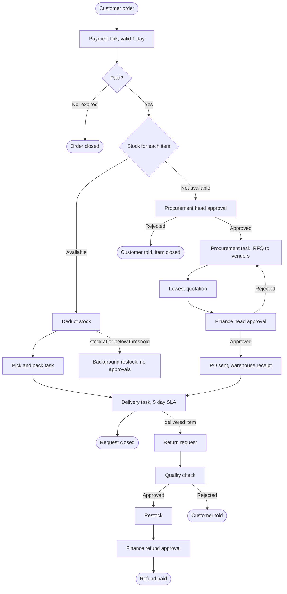
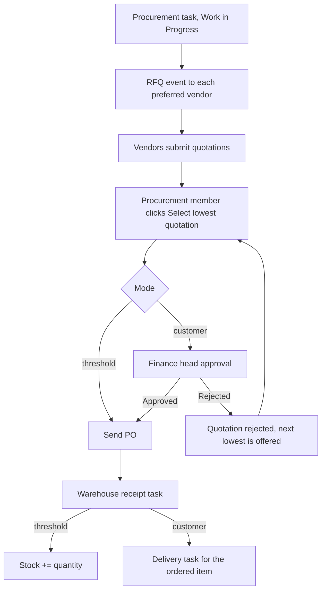

# Timber Track: ServiceNow order, procurement & returns automation

[](https://github.com/mohd-21/timber-track-servicenow/actions/workflows/ci.yml)

A ServiceNow implementation of a timber-supply order lifecycle: payment, stock check, pick & pack,
delivery, automatic restocking, procurement with two approval gates, and returns with refunds.
Built from the workflow diagrams of a project I worked on during my internship.
All logic lives in ES5 Script Includes (as ServiceNow requires); Business Rules are one-line wrappers.

## Overview



## The four scenarios

| # | Scenario | Key rules |
|---|---|---|
| 1 | All items available | Stock deducted on payment; one pick & pack task per warehouse owner; delivery task due in 5 days |
| 2 | Falls to or below threshold | Fixed reorder quantity (property, default 100); RFQ to all preferred vendors; lowest quote gets the PO directly; **no approvals**; stock increases when the warehouse receipt closes |
| 3 | Item unavailable | Procurement head approves, quantity follows the order; lowest quote needs finance head approval; goods go straight to delivery |
| 4 | Return | Delivery quality check, then restock, then finance refund approval |



## Project layout

```
src/script_includes/   TimberTrackConfig, Tasks, Approvals, Payment, Inventory,
                       Procurement, Fulfilment, Returns, Router
src/business_rules/    thin wrappers on sc_task, u_approval_request, u_payment
src/ui_actions/        Select lowest quotation
src/scheduled_jobs/    expire stale payment links
tests/                 strict mock platform + 58 tests
docs/                  data model, events, setup
```

## Tests

```bash
npm install   # Node 22 or newer (uses the built-in test runner glob support)
npm test
```

The tests run the real Script Include source inside a Node `vm` sandbox against a strict mock of
GlideRecord/GlideDateTime/`gs`. Changes only persist on `update()`/`insert()`, and an `update()`
fires the table's Business Rule, so a forgotten `update()` fails a test. A syntax test parses every
file as ES5. I also mutation-tested the suite (wrong comparison, highest vs lowest quote, missing
restock, and so on) and each mutation was caught.

## Design assumptions and limitations

- Tested against a mock, not a live instance.
- Delivery batching: one delivery task per warehouse owner's batch; the request closes when every non-rejected item is covered by a closed delivery task.
- A finance rejection of a refund sets the payment to `refund_rejected` and raises an event. The spec did not define it.
- Payment gateway and vendor form integrations are entry points (`markPaid`, `onQuotationSubmitted`), not built.
- Concurrent orders for the same stock are not locked.
- Logic is in Script Includes instead of Flow Designer so it can be unit tested.
